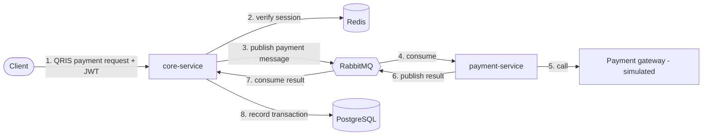

# Livwell

Livwell by Tipen is an e-wallet backend that lets users top up, transfer, pay with QRIS, and track their expenses. It is split into two services, core-service and payment-service, because payment handles much more traffic than the other features and needs to scale on its own. Built with Go, Gin, PostgreSQL, Redis, and RabbitMQ.

## Features

- **Top up:** add balance to a wallet.
- **Transfer:** send money from one wallet to another.
- **Pay:** pay with QRIS, processed asynchronously through payment-service.
- **Expense tracking:** view spending history.

## Architecture



### How a payment works

1. **core-service** receives the QRIS payment request and publishes a payment message to RabbitMQ.
2. **payment-service** consumes the message and sends the payment to the payment gateway (simulated in this project).
3. **payment-service** publishes the payment result back to RabbitMQ.
4. **core-service** consumes the result and records the transaction in PostgreSQL.

### Design decisions

- **Payment is a separate service.** Payment handles much more traffic than top-up and transfer, so it can be scaled on its own.
- **Payment-service only talks to the outside world.** It handles communication with external payment providers (simulated here), so the hardest and least predictable part of the system is isolated from the core logic.
- **Communication goes through RabbitMQ.** A slow payment gateway never blocks core-service.
- **Authentication stays in core-service.** JWT sessions are verified against Redis at the entry point, so payment-service only receives requests that were already verified.

## Getting Started

**Requirements:** Docker and Docker Compose

```bash
git clone https://github.com/Tippenn/E-wallet-MicroService.git
cd E-wallet-MicroService
docker compose up --build
```

This starts core-service, payment-service, PostgreSQL, Redis, and RabbitMQ together. core-service is available at `http://localhost:8080`.

## API Endpoints

All routes start with `/api/v1`.

| Method | Endpoint | Auth | Description |
|--------|----------|------|-------------|
| POST | `/users/register` | No | Create a new account |
| POST | `/users/login` | No | Log in and get a JWT |
| GET | `/wallet/balance` | Yes | Check wallet balance |
| POST | `/transactions/topup` | Yes | Top up wallet balance |
| POST | `/transactions/transfer` | Yes | Transfer to another wallet |
| POST | `/transactions/pay` | Yes | Pay with QRIS (processed by payment-service) |
| GET | `/transactions/history` | Yes | View transaction history (supports `page` and `limit`) |

Routes marked "Yes" need a valid JWT from the login endpoint.

## Try It Out

With the project running, you can try the main flow with `curl`.

> **Windows (PowerShell):** use `curl.exe` instead of `curl`, and set the token with `$TOKEN = "..."`. PowerShell also mangles JSON quotes, so save each JSON body to a file and send it with `-d "@body.json"`. Git Bash works with the commands below as written.

**1. Register**

```bash
curl -X POST http://localhost:8080/api/v1/users/register \
  -H "Content-Type: application/json" \
  -d '{"name": "John Doe", "email": "john.doe@example.com", "password": "a-very-secure-password"}'
```

**2. Log in and copy the token from the response**

```bash
curl -X POST http://localhost:8080/api/v1/users/login \
  -H "Content-Type: application/json" \
  -d '{"email": "john.doe@example.com", "password": "a-very-secure-password"}'
```

Save the token so the next commands can use it:

```bash
export TOKEN="paste-your-token-here"
```

**3. Top up**

```bash
curl -X POST http://localhost:8080/api/v1/transactions/topup \
  -H "Authorization: Bearer $TOKEN" \
  -H "Content-Type: application/json" \
  -d '{"amount": 100000}'
```

**4. Check balance**

```bash
curl http://localhost:8080/api/v1/wallet/balance \
  -H "Authorization: Bearer $TOKEN"
```

**5. Transfer to another user** (use the `userID` from that user's register response)

```bash
curl -X POST http://localhost:8080/api/v1/transactions/transfer \
  -H "Authorization: Bearer $TOKEN" \
  -H "Content-Type: application/json" \
  -d '{"toUserID": "<recipient-user-id>", "amount": 25000}'
```

**6. Pay a merchant**

Payments require an `Idempotency-Key` header: a unique label for each payment, so that retrying the same request never charges twice. Use a new value for every payment.

```bash
curl -X POST http://localhost:8080/api/v1/transactions/pay \
  -H "Authorization: Bearer $TOKEN" \
  -H "Content-Type: application/json" \
  -H "Idempotency-Key: pay-001" \
  -d '{"merchantID": "merchant-123", "amount": 15000, "description": "Coffee and croissant"}'
```

**7. View transaction history**

```bash
curl "http://localhost:8080/api/v1/transactions/history?page=1&limit=10" \
  -H "Authorization: Bearer $TOKEN"
```
